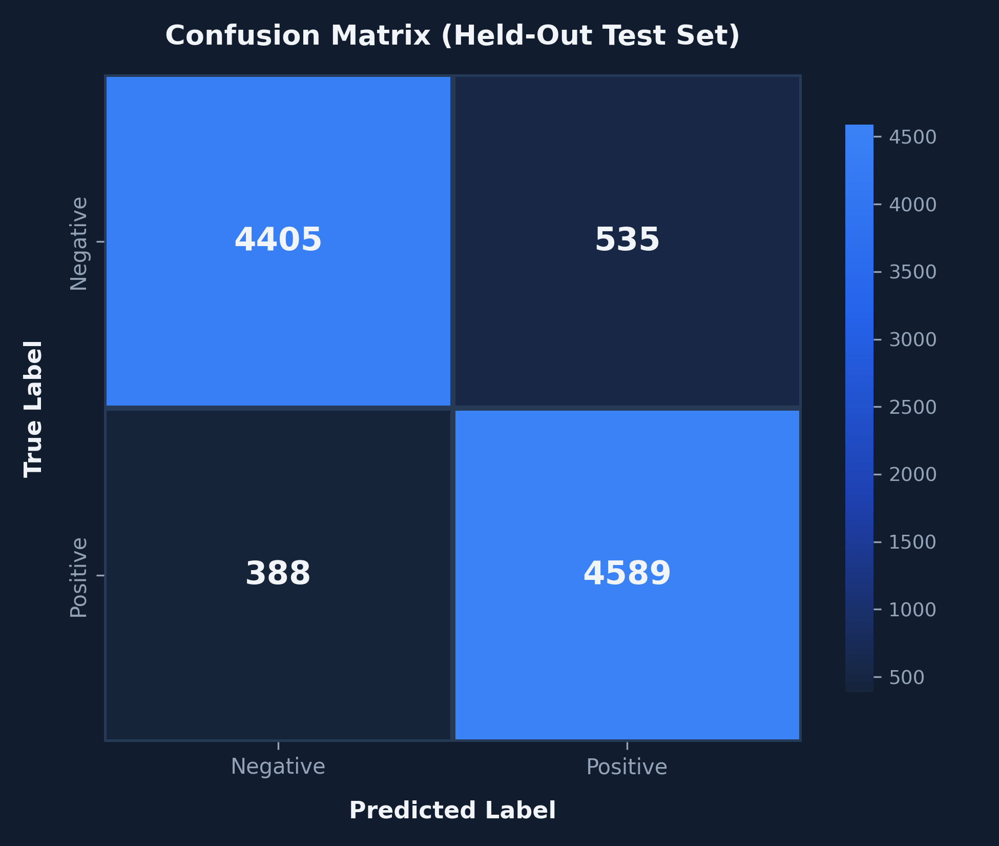
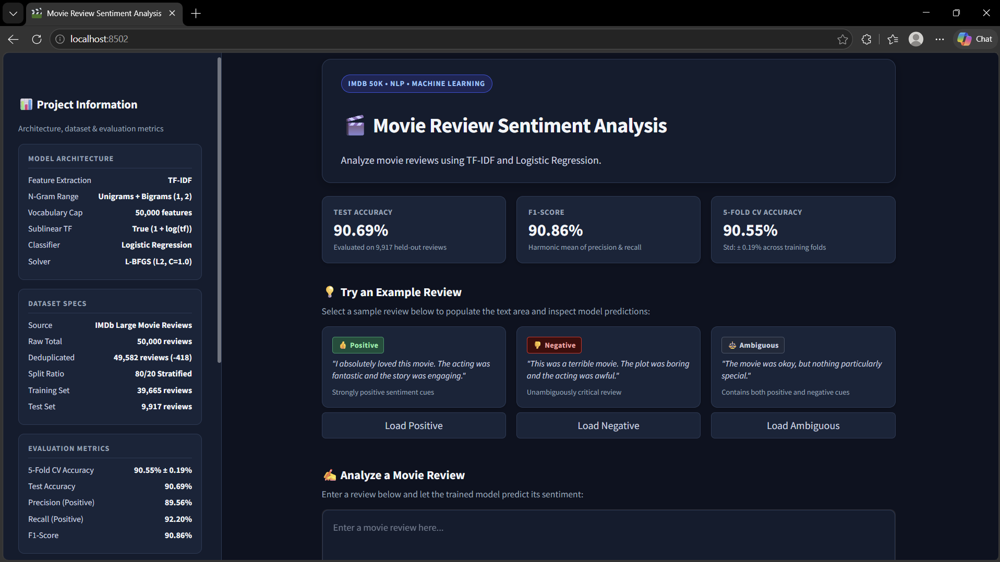
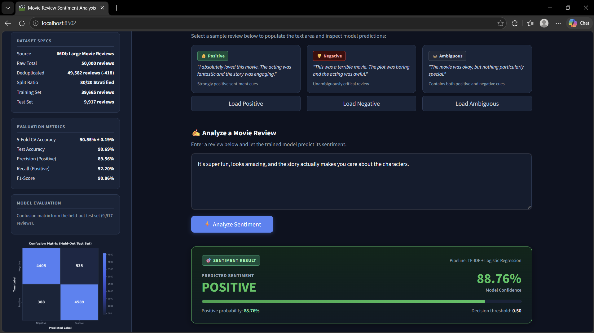
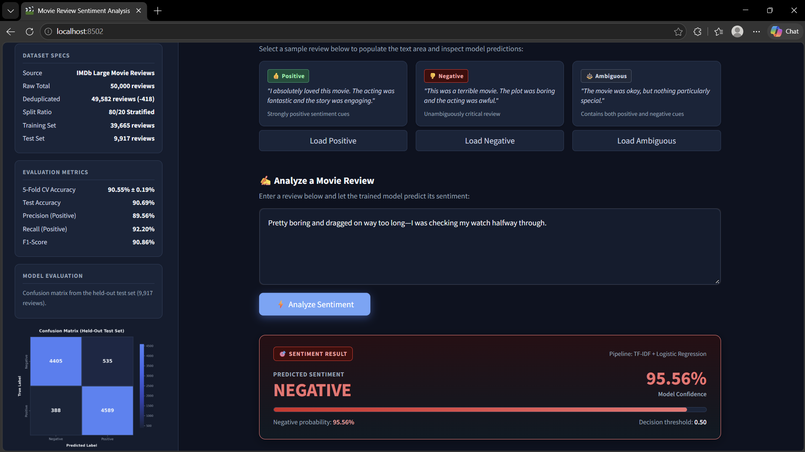
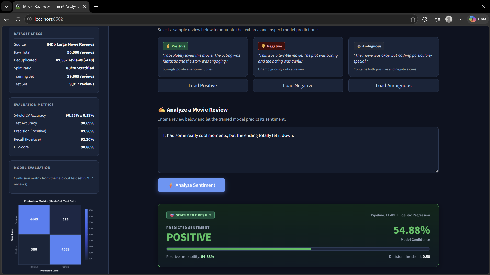

# 🎬 Movie Review Sentiment Analysis

[](https://www.python.org/)
[](https://opensource.org/licenses/MIT)
[](https://scikit-learn.org/)
[](https://streamlit.io/)
[](https://docs.pytest.org/)

An end-to-end Natural Language Processing (NLP) binary sentiment classification pipeline trained on the IMDb 50K movie reviews dataset. Built as a portfolio-ready Machine Learning project for the **Horizon Intern Machine Learning Internship**, this repository combines TF-IDF n-gram feature extraction, Logistic Regression, rigorous evaluation metrics, an interactive Streamlit web interface, and an automated test suite.

---

## Features

- **Binary Sentiment Classification**: Accurately categorizes movie reviews as either Positive or Negative.
- **N-Gram TF-IDF Vectorization**: Extracts sublinear-scaled unigrams and bigrams up to a 50,000 vocabulary limit.
- **Prediction Confidence Scores**: Surfaces prediction confidence directly via `predict_proba()`.
- **Zero Data Leakage Architecture**: Feature extraction and classifier are encapsulated in a single `sklearn.pipeline.Pipeline` fitted strictly on training data.
- **Interactive Streamlit Web UI**: Real-time review classification with quick-select sample buttons and visual confidence meters.
- **Confusion Matrix Visualization**: Generates a confusion matrix heatmap for model analysis.
- **Serialized Model Artifact**: Pre-trained, deployable `.joblib` pipeline (~2.15 MB) enabling instant cold starts without retraining.
- **Comprehensive Unit Testing**: 10 automated pytest tests covering text normalization edge cases, artifact schemas, and input validation.

---
## Key Results

| Metric | Result |
|---|---:|
| Test Accuracy | **90.69%** |
| F1-Score | **90.86%** |
| Positive Precision | **89.56%** |
| Positive Recall | **92.20%** |
| 5-Fold CV Accuracy | **90.55% ± 0.19 pp** |
| Test Samples | **9,917** |

## Tech Stack

| Technology | Purpose |
| :--- | :--- |
| **Python** | Core programming language |
| **Pandas** | Dataset ingestion, deduplication, and quality inspection |
| **NumPy** | Numerical computations and vector operations |
| **scikit-learn** | Pipeline construction, TF-IDF vectorization, Logistic Regression, and metrics |
| **Matplotlib / Seaborn** | Evaluation report visualization and confusion matrix heatmaps |
| **Streamlit** | Interactive browser frontend for live inference |
| **Joblib** | Serialization and deserialization of the trained pipeline |
| **Pytest** | Automated unit and integration testing suite |

---

## Dataset

- **Source**: IMDb Large Movie Review Dataset (50,000 raw reviews).
- **Initial Class Distribution**: 25,000 Positive reviews and 25,000 Negative reviews (50% / 50% balanced).
- **Data Quality & Cleaning**:
  - Zero missing review entries or missing sentiment labels detected.
  - Removed **418 exact duplicate reviews** to prevent data snooping across splits.
  - **Final Cleaned Dataset**: **49,582 reviews**.
- **Stratified Partitioning**:
  - Stratified 80/20 train/test split preserving class proportions through stratified sampling.
  - **Training Set (`X_train`)**: **39,665 reviews** (19,758 negative, 19,833 positive).
  - **Held-Out Test Set (`X_test`)**: **9,917 reviews** (4,940 negative, 4,977 positive).

> **Note on Dataset Exclusion**:  
> In accordance with repository size and data distribution best practices, the 66 MB raw CSV (`data/IMDB Dataset.csv`) is excluded from Git tracking via `.gitignore`. The repository includes the pre-trained model artifact (`models/sentiment_pipeline.joblib`) so the web app and inference run out-of-the-box. To retrain from scratch, download the IMDb Dataset CSV from Kaggle or Stanford AI and place it in the `data/` directory.

---

## Machine Learning Pipeline

```text
Raw Review Text
      ↓
Text Cleaning (clean_text)
      ↓
TF-IDF Vectorization
      ├── N-Gram Range: (1, 2) [Unigrams + Bigrams]
      ├── max_features = 50,000
      ├── min_df = 5
      └── sublinear_tf = True
      ↓
Logistic Regression Classifier
      ├── Penalty: L2
      ├── C = 1.0
      └── Solver: lbfgs (max_iter = 1000)
      ↓
Sentiment Label ('positive' / 'negative') + Confidence Score
```

Feature extraction and classification are contained within a single `sklearn.pipeline.Pipeline`. This ensures that all cleaning, vocabulary mappings, and inverse-document-frequency weights learned during training are applied identically during inference, eliminating train-test preprocessing mismatches.

---

## Text Preprocessing

The preprocessing module (`src/preprocessing.py`) applies targeted, transparent cleaning without external heavy NLP dependencies:
1. **HTML Tag Stripping**: Removes `<br />`, `<p>`, and web markup common in scraped reviews.
2. **Character Filtering**: Strips noisy symbols and punctuation using regular expressions while retaining alphanumeric characters and spaces.
3. **Casing Normalization**: Converts all text to lowercase for consistent vocabulary indexing.
4. **Whitespace Collapsing**: Trims leading/trailing spaces and condenses repeated whitespace into single spaces.

*Note: In accordance with modern classical NLP practices, aggressive stemming, lemmatization, and stop-word deletion were intentionally avoided to preserve sentiment context (e.g., negations such as "not bad" or "never boring").*

---

## Model Evaluation

### Evaluation Methodology
Cross-validation was performed strictly on the training partition (`X_train`), while the test set (`X_test`) remained completely untouched until final scoring. This guarantees that test performance reflects true generalization to unseen real-world data.

### Benchmark Results

| Metric | Result |
| :--- | :---: |
| **5-Fold Cross-Validation Accuracy** | **90.55% ± 0.19 percentage points** |
| **Test Accuracy** | **90.69%** |
| **Precision (Positive Class)** | **89.56%** |
| **Recall (Positive Class)** | **92.20%** |
| **F1-Score (Positive Class)** | **90.86%** |

### Detailed Classification Report (9,917 Unseen Reviews)

```text
              precision    recall  f1-score   support

    Negative       0.92      0.89      0.91      4940
    Positive       0.90      0.92      0.91      4977

    accuracy                           0.91      9917
   macro avg       0.91      0.91      0.91      9917
weighted avg       0.91      0.91      0.91      9917
```

---

## Confusion Matrix



### Breakdown on 9,917 Test Samples:
- **True Negatives (TN)**: `4,405` reviews correctly identified as Negative.
- **False Positives (FP)**: `535` negative reviews misclassified as Positive.
- **False Negatives (FN)**: `388` positive reviews misclassified as Negative.
- **True Positives (TP)**: `4,589` reviews correctly identified as Positive.

The model demonstrates strong balance across both classes, achieving a 92.20% sensitivity (recall) on positive reviews while keeping false alarms low.

## Application Screenshots

### Dashboard



### Positive Prediction



### Negative Prediction



### Ambiguous Review


---

## Project Structure

```text
Sentiment_Analysis/
├── .gitignore                     # Ignores virtualenv, raw data, caches, and temp files
├── README.md                      # Comprehensive project documentation
├── DEMO.md                        # Quick 1-2 minute presentation walkthrough
├── requirements.txt               # Pinned dependencies
│
├── data/
│   └── .gitkeep                   # Data directory placeholder (raw CSV is gitignored)
│
├── models/
│   ├── .gitkeep
│   └── sentiment_pipeline.joblib  # Serialized end-to-end trained pipeline (~2.15 MB)
│
├── reports/
│   └── confusion_matrix.png       # Generated confusion matrix evaluation heatmap
│
├── src/                           # Modular ML application package
│   ├── __init__.py
│   ├── config.py                  # Central paths and reproducibility seeds
│   ├── dataset.py                 # Dataset loading, cleaning, and stratified splitting
│   ├── preprocessing.py           # Text normalization and TF-IDF vectorization
│   ├── train.py                   # Pipeline training, 5-fold CV, evaluation, and export
│   └── predict.py                 # Lightweight inference service (predict & confidence)
│
├── app/
│   └── streamlit_app.py           # Interactive Streamlit web application
│
└── tests/                         # Automated unit testing suite
    ├── __init__.py
    └── test_pipeline.py           # 10 pytest unit tests
```

---

## Getting Started

### 1. Clone the Repository
```bash
git clone <repository-url>
cd Sentiment_Analysis
```

### 2. Set Up Virtual Environment
```bash
# Windows PowerShell
python -m venv .venv
.venv\Scripts\Activate.ps1

# macOS / Linux
python3 -m venv .venv
source .venv/bin/activate
```

### 3. Install Dependencies
```bash
pip install --upgrade pip
pip install -r requirements.txt
```

---

## Training the Model

To run the complete data loading, stratified train/test split, 5-fold cross-validation, final model fitting, evaluation, and serialization:

```bash
python -m src.train
```

This updates `reports/confusion_matrix.png` and exports the deployable pipeline to `models/sentiment_pipeline.joblib`.

---

## Running the Streamlit Web App

Launch the interactive web interface:

```bash
streamlit run app/streamlit_app.py
```

Open your browser to `http://localhost:8501`. The application loads `models/sentiment_pipeline.joblib` via `@st.cache_resource` and performs instant inference without retraining.

---

## Running Automated Tests

Run the full pytest suite:

```bash
pytest -v
```

**Verified Test Output**:
```text
tests/test_pipeline.py::test_clean_text_edge_cases PASSED                [ 10%]
tests/test_pipeline.py::test_model_loading PASSED                        [ 20%]
tests/test_pipeline.py::test_predict_sentiment_valid PASSED              [ 30%]
tests/test_pipeline.py::test_predict_probabilities_and_confidence PASSED [ 40%]
tests/test_pipeline.py::test_predict_invalid_inputs[] PASSED             [ 50%]
tests/test_pipeline.py::test_predict_invalid_inputs[   ] PASSED          [ 60%]
tests/test_pipeline.py::test_predict_invalid_inputs[\t\n  ] PASSED       [ 70%]
tests/test_pipeline.py::test_predict_invalid_inputs[999] PASSED          [ 80%]
tests/test_pipeline.py::test_predict_invalid_inputs[None] PASSED         [ 90%]
tests/test_pipeline.py::test_predict_invalid_inputs[invalid_input5] PASSED [100%]

============================= 10 passed in 1.78s ==============================
```

---

## Example Inferences

The following are **observed outputs** produced by the trained pipeline:

### 1. Strongly Positive Review
- **Input**: `"I absolutely loved this movie. The acting was fantastic and the story was engaging."`
- **Prediction**: `positive`
- **Confidence**: `90.88%`

### 2. Strongly Negative Review
- **Input**: `"This was a terrible movie. The plot was boring and the acting was awful."`
- **Prediction**: `negative`
- **Confidence**: `99.91%`

### 3. Mixed / Subtle Review
- **Input**: `"The movie was okay, but nothing particularly special."`
- **Prediction**: `negative`
- **Confidence**: `94.72%`

---

## Design Decisions

- **Why TF-IDF?**: TF-IDF with unigrams and bigrams provides an strong and interpretable baseline for document-level sentiment classification. It balances rich lexical feature representations with sparse computational efficiency.
- **Why Logistic Regression?**: High-dimensional sparse TF-IDF spaces (50,000 features) are linearly separable to a high degree. Logistic Regression with L2 regularization is computationally lightweight, prevents overfitting, converges quickly via L-BFGS, and outputs well-calibrated class probabilities via `predict_proba()`.
- **Why an sklearn Pipeline?**: Bundling vectorization and classification into one object prevents data leakage during cross-validation and guarantees identical text transformations between training and production inference.
- **Why Classical NLP over Deep Learning?**: Rather than introducing opaque, resource-heavy transformer architectures or GPU dependencies, this project intentionally focuses on engineering a transparent, interpretable, reproducible, and easily deployable baseline.

---

## Limitations

- **Binary Restriction**: Classifies inputs strictly into positive or negative categories without an explicit neutral or multi-emotion rating.
- **Complex Semantics & Sarcasm**: Like most n-gram bag-of-words models, subtle irony, sarcasm, and nuanced mixed critiques may be misclassified if negative lexicon outweighs positive sentiment words.
- **Domain Specificity**: The model is trained specifically on long-form movie reviews; vocabulary distributions may degrade when applied to micro-texts (such as short tweets) or financial news.
- **Confidence Interpretation**: Confidence figures reflect output class probabilities from the logistic sigmoid function, not guaranteed human truth.

---

## Future Improvements

- Benchmark against Linear Support Vector Classifiers (LinearSVC) and Multinomial Naive Bayes.
- Implement automated hyperparameter tuning (regularization `C` and n-gram boundaries).
- Introduce explicit handling for negation modifiers (e.g., compounding "not" with adjacent tokens).
- Compare performance with a distilled transformer architecture (such as DistilBERT).
- Expand evaluation across out-of-domain movie and product review corpora.

---

## Author

**Rishit Yengandula**  
*B.Tech Computer Science Engineering*
